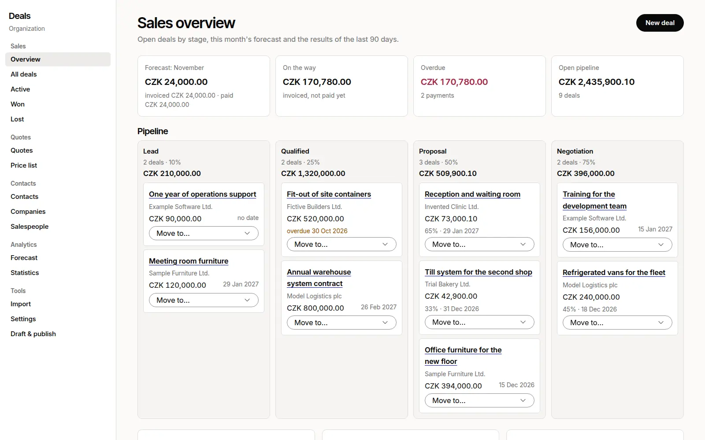
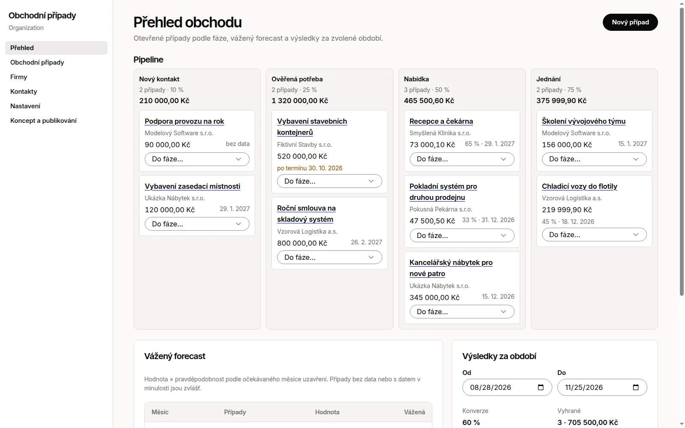

# Deals

A sales pipeline for a Lazurio Organization: deals and their salespeople, the
companies and people they are with, what happened on them, quotes from a price
list, a forecast of what won deals invoice month by month and the results of a
period against the one before. Deals is a Module of the
[Lazurio Module Standard](https://github.com/Lazurio/LazurioPlatform/blob/main/docs/module-standard.md)
and a template of the Lazurio Marketplace, published by LazurioTemplates as the
public upstream `LazurioTemplates/deals` under the MIT license. In Czech it is
called „Obchodní případy“.



- **Pipeline.** Stages in the Organization's order, each with a probability,
  plus exactly one won and one lost stage, all data in the settings. Deals
  are a table with sortable, movable and resizable columns, kept per viewer,
  or a board by stage with drag and drop; tabs for all, active, won and lost.
  Won asks for the final value, the day and how it is invoiced; lost for a
  reason from the settings, a note and the day.
- **Salespeople, deals, companies and contacts.** A salesperson is a record
  (who left stays, inactive); a deal names its salesperson, company,
  contacts, deal type and billing entity, a value without VAT, an expected
  closing date and, if it differs from its stage's, its own probability. A
  company may carry its IČO (checked modulo 11, never twice), its address
  and its own days to pay; the App can fill it in from ARES, asked only by
  the server, when the Organization turns that on.
- **Activities.** Calls, meetings, e-mails, notes and tasks on a deal, newest
  first; a task is ticked off.
- **Quotes and the price list.** A quote of a deal starts from the price
  list and the settings' defaults; lines in sections with a quantity, a
  unit price and a discount, one VAT rate or reverse charge, a reserve for
  changes, the texts of the terms and a record of the commercial terms the
  customer accepted. A revision is a record of its own, so what was sent
  never changes; the approved quote sets the deal's value. A print view
  makes it a PDF; the App sends nothing.
- **Forecast.** What won deals invoice: their payment plans month by month
  and manual rows (a recurring fee, a contract outside the pipeline), each
  payment planned, invoiced, overdue or paid, by month and quarter, grouped
  and filtered by salesperson, deal type and billing entity, with notes on a
  month. A won deal without a plan waits among the unassigned. Never a
  weighted guess over open deals.
- **Statistics.** For any period (presets from today to last year): won,
  lost, new deals and quotes against the previous period, the conversion,
  the average win and sales cycle, the open pipeline, a leaderboard of the
  salespeople, charts by week or month and the won value day by day; every
  number opens the deals behind it. Amounts are whole haléře, never floating
  point.
- **Import.** Companies, contacts and deals from a CSV export (a
  spreadsheet, a CRM), with a preview row by row, as one draft.
- **Rules across records.** A deal names a company, contacts, a salesperson,
  a stage and a reason that exist; a won deal has a value and a date, a
  lost one a reason; a payment plan adds up to the value; a stage, a reason,
  a deal type or an entity in use cannot be removed. An error stops a save
  and a publication; a warning (an open deal without a date, a salesperson
  who left, a value that differs from its quote) is shown and stops nothing.
- **For agents.** Four skills (`.agents/skills/`): create a deal from a
  message, prepare a quote, review the pipeline for the week, close a deal.
  The App's tools for agents are defined once on its server, offered on
  `/mcp` of the Application and as WebMCP tools in the Environment browser;
  they list only what the person's role and the writer mode allow. One of
  them, `publish_draft`, publishes, and an agent calls it only on the
  person's instruction.
- **Draft & Publish.** Every save is a draft; a person reviews the changed
  records in business language and publishes them as one change to the
  Organization's data repository, or returns them.



The App speaks Czech or English: `?lang=` in the address first, then the
language of the person's Lazurio profile where Lazurio hands it to the page
(`/.lazurio/shell.json`), otherwise Czech. The records hold whatever language
the Organization writes in; both starts ship in both languages.

## How it is built

| | |
| --- | --- |
| App generation | `app/v3`: data in [repository-db](https://github.com/Lazurio/repository-db) |
| Stack profile | [`app-data@2027.03`](https://github.com/Lazurio/LazurioPlatform/blob/main/docs/stack-profiles.md#app-data): Bun 1.4.4, TypeScript 7.0.2, Vite 8.3.5, React 19.3.1, Biome 2.6.4, Zod 4.6.7, `@lazurio/repository-db` v3.4.0, `@lazurio/module-kit` v0.6.0, exact versions only |
| Data | the Organization's own repository `deals-data`, branch `v3`, checked out as `db/` |
| Shape of the data | Zod schemas in `app/v3/src/domain/`; the JSON Schemas of the data repository are generated from them |
| Look of the App | the package `design-system`: [LazurioTemplates/design-system](https://github.com/LazurioTemplates/design-system) v2.2.0, a dependency on its released tag; the Organization's own design system replaces it by one line |

```text
app/v3/src/
  domain/     Zod schemas and pure logic: money, quotes, payment plans, rules across records,
              the forecast, the statistics, the periods
  data/       the storage port (store.ts), its repository-db and memory implementations
  service/    the operations the API and the tools share
  server/     Bun.serve: the HTTP API over the port, ARES, the tools for agents (/mcp and the page),
              health, the client, the demo
  ui/         React; talks only to the HTTP API; registers the server's tools for agents
  cli/        validation, schema export and the migration of the data (bun run migrate)
  i18n/       the two languages
app/v3/seed/<cs|en>/<empty|sample>/   the starts, laid out like db/data/
app/v3/tests/store-contract.ts        the shared test suite every store implementation passes
templates/data-repo/                  the data repository an adopting Organization starts from
.agents/skills/, .claude/skills/      the process for agents (the same files for Codex and Claude Code)
```

The server never runs Git on the data and never reads a record file by a path
it built: every read and write goes through the storage port, which in `v3`
is repository-db's sync host. A later generation replaces only that port
implementation; see [`docs/extending.md`](docs/extending.md).

## Run it

Lazurio starts the App from its Module manifest: `lazurio module start
<Organization>/deals`. To work on it in a worktree:

```bash
cd app/v3
bun install --frozen-lockfile
bun run check          # typecheck, Biome, generated schemas, the starts, tests
LAZURIO_RUNTIME_LISTENER_APP_HOST=127.0.0.1 LAZURIO_RUNTIME_LISTENER_APP_PORT=<free port> bun run dev
```

`bun run dev` serves the data checkout `db/` at the Module root. Without one,
the App runs and says that the data is not available yet.

`bun run dev:demo` (or `bun run dev:demo en`) serves the fictional example in
memory instead: nothing is read from or written to a repository, ARES is never
asked, and every change is gone when the process ends. It needs the same
listener as `bun run dev`; without it the process exits 2:

```bash
LAZURIO_RUNTIME_LISTENER_APP_HOST=127.0.0.1 LAZURIO_RUNTIME_LISTENER_APP_PORT=<free port> bun run dev:demo
LAZURIO_RUNTIME_LISTENER_APP_HOST=127.0.0.1 LAZURIO_RUNTIME_LISTENER_APP_PORT=<free port> bun run dev:demo en
```

Outside Lazurio, add `?lang=en` to the address for the English interface.
The Marketplace screenshots come from it.

| Script | Does |
| --- | --- |
| `check` | the one gate: `typecheck`, `lint`, `schema:check`, `validate:data`, `bun test` |
| `dev:demo` | the App over the fictional example in memory |
| `validate:db` | checks the data checkout `db/` (draft included) against the schemas and the rules across records |
| `schema:export` | regenerates `templates/data-repo/schemas/*.schema.json` from the Zod schemas |
| `migrate` | `bun run migrate <data directory> [--lang cs\|en] [--write]`: takes 0.1.x data to 0.2.0 ([`docs/data.md`](docs/data.md)) |
| `build` | the client build of the built version (`dist/`) |

CI runs `bun run check` and `bun run build` on Linux, the same check on
Windows, and `lazurio module readiness`, which must say `ready-for-live`.

## Adopt it

The Marketplace in Lazurio hands an agent a brief; the agent follows
[`docs/adoption.md`](docs/adoption.md): it checks rights and name collisions,
creates a private Module with its data repository by `lazurio module create
--data`, merges the released commit so it stays an ancestor, prepares the data
in the person's language and opens pull requests. Nothing is merged, published
or sent without the person's instruction. An Organization on 0.1.x takes
0.2.0 with the migration of its data ([`docs/adoption.md`](docs/adoption.md),
"Taking 0.2.0"); 0.3.0 changes only the look and the pages, not the data, and
is taken as a merge.

## Screens

| | Czech | English |
| --- | --- | --- |
| Overview | [`cs/overview.webp`](docs/screenshots/cs/overview.webp) | [`en/overview.webp`](docs/screenshots/en/overview.webp) |
| Deals | [`cs/deals.webp`](docs/screenshots/cs/deals.webp) | [`en/deals.webp`](docs/screenshots/en/deals.webp) |
| A deal with its activities | [`cs/deal.webp`](docs/screenshots/cs/deal.webp) | [`en/deal.webp`](docs/screenshots/en/deal.webp) |
| A quote in the editor | [`cs/quote.webp`](docs/screenshots/cs/quote.webp) | [`en/quote.webp`](docs/screenshots/en/quote.webp) |
| The forecast of payment plans | [`cs/forecast.webp`](docs/screenshots/cs/forecast.webp) | [`en/forecast.webp`](docs/screenshots/en/forecast.webp) |
| Statistics against the previous period | [`cs/stats.webp`](docs/screenshots/cs/stats.webp) | [`en/stats.webp`](docs/screenshots/en/stats.webp) |

The navigation groups the pages in sections: Obchod / Sales (the overview and
the deals by tab), Nabídky / Quotes (the quotes with their print view, the
price list), Kontakty / Contacts (contacts, companies, salespeople),
Analytika / Analytics (the forecast, the statistics) and Nástroje / Tools
(the import, the settings).

## Documents

- [`AGENTS.md`](AGENTS.md): rules for agents working on this repository and in an adopted Module
- [`docs/adoption.md`](docs/adoption.md): taking the template into an Organization
- [`docs/extending.md`](docs/extending.md): changes within the generation, the look of the App,
  taking template updates, stack profile releases, the next generation
- [`docs/data.md`](docs/data.md): the records, money in haléře, the payment plan, the rules,
  the forecast and the statistics, the migration from 0.1.x, the data repository
- [`docs/agents.md`](docs/agents.md): the tools for agents and their effects, the skills
- [`CHANGELOG.md`](CHANGELOG.md), [`SECURITY.md`](SECURITY.md), [`CONTRIBUTING.md`](CONTRIBUTING.md), [`NOTICE.md`](NOTICE.md)

## License

MIT, see [`LICENSE`](LICENSE).
